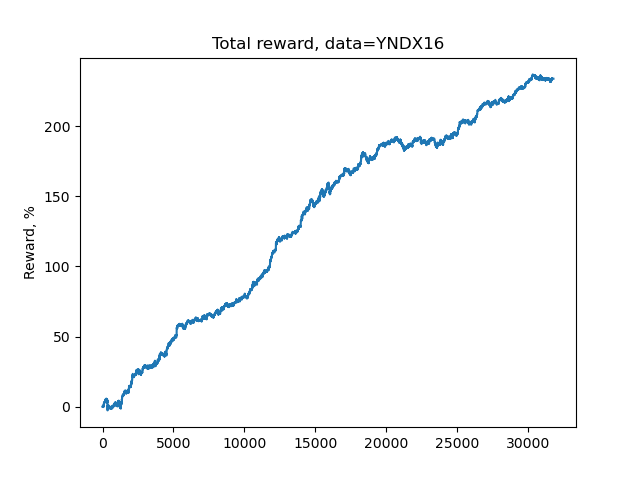
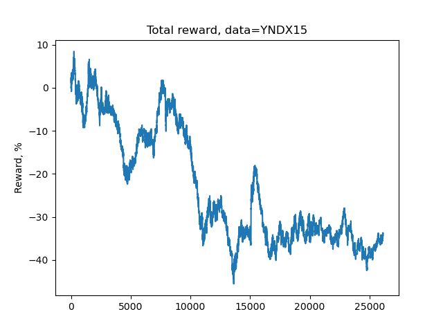
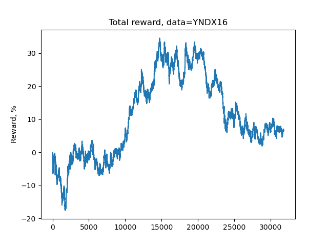
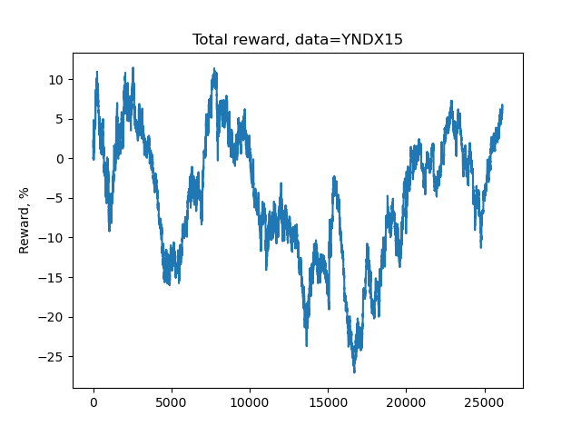
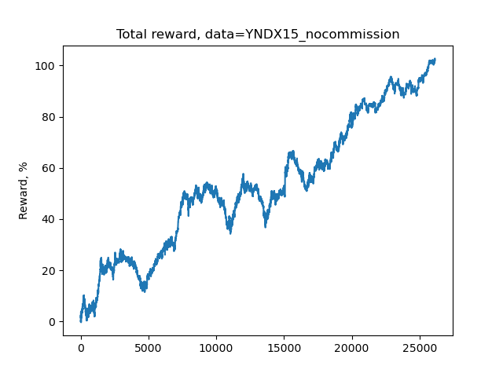
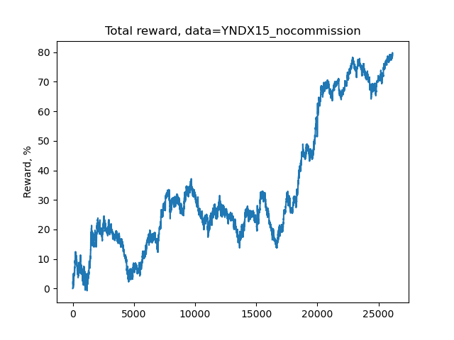
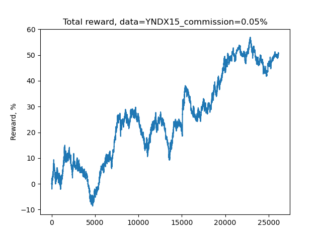
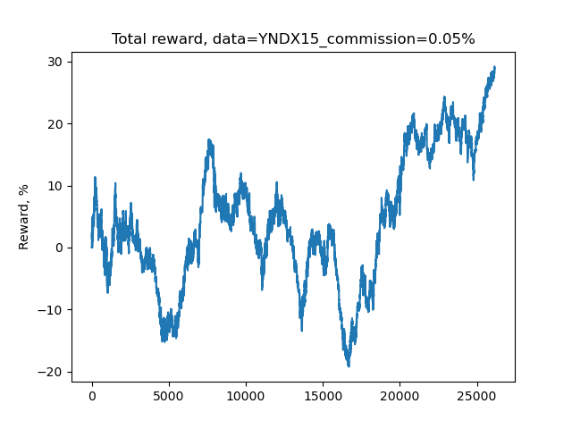

# DQN-Based Stock Trading Agent

**An experimental deep reinforcement learning study of market observation windows and transaction costs.**

[](https://www.python.org/)
[](https://pytorch.org/)
[](#limitations)

> **Research / educational use only.** This repository demonstrates an RL training and evaluation workflow; it does not establish profitability on unseen future markets and is not an automated live-trading system.

## Overview

This academic project explores how a Deep Q-Network (DQN) trading agent responds to historical price movements. Using Yandex (YNDX) market data, the experiments compare two observation-window configurations (**10 bars vs. 3 bars**) and investigate the impact of simulated transaction commissions on cumulative rewards.

The research questions were:

1. How do shorter and longer observation windows affect the agent's simulated trading behavior?
2. How sensitive are cumulative rewards to transaction costs?
3. How well do the learned policies transfer between the historical periods used in the study?

**Scope of my contribution:** reproducing and adapting an existing RL trading implementation for an academic assignment, running both observation-window experiments, exploring commission scenarios, recording the results, and interpreting the findings. The underlying training framework, environment, and core model design originate from the reference implementation credited below.

## Experiment at a glance

| Item | Setting |
|---|---|
| Instrument | Yandex (YNDX) historical market quotes |
| Historical periods | 2015 and 2016 |
| Original training period | 2016 |
| Original validation period | 2015 |
| Agent | DQN with dueling value/advantage architecture |
| Actions | Skip / Buy / Close |
| Observation windows | 10 bars and 3 bars |
| Evaluation | Cumulative simulation reward and commission sensitivity |
| Approximate training time | 12 hours per documented configuration (reported in the original assignment) |

**Important chronology caveat:** The historical assignment trains on 2016 and evaluates on 2015, an earlier period. Thus the figures should not be interpreted as a forward chronological out-of-sample backtest. A stronger follow-up study would train on earlier years and test on later unseen years.

## Architecture

```text
Historical YNDX quotes (CSV)
            |
     Data preprocessing
            |
  StocksEnv (Gymnasium)
  state = relative market features + position state
  actions = Skip / Buy / Close
  rewards = price changes - commissions
            |
     Dueling DQN network
      /             \
  State value     Action advantages
      \             /
           Q-values
              |
  Epsilon-greedy decision policy
              |
 Experience replay + target network
              |
 Training, validation and checkpointing
              |
 Simulated evaluation & reward charts
```

The repository also contains an optional convolutional training script (`train_model_conv.py`), but the documented results below correspond to the feed-forward agent rather than a measured CNN-vs-MLP comparison.

## Results and visualizations

The included plots are traces of **cumulative simulated reward**, not verified net financial returns from live trading. No specific percentage performance or superiority claim is inferred from chart filenames.

### 10-bar observation window

| Historical training period (2016) | Historical validation period (2015) |
|---|---|
|  |  |

### 3-bar observation window

| Historical training period (2016) | Historical validation period (2015) |
|---|---|
|  |  |

### Commission sensitivity

Commission changes influence rewards in the simulation. The repository preserves additional runs with varied assumed fees; they must be compared under equivalent data and model settings.

| 10 bars (2015) | 3 bars (2015) |
|---|---|
|  |  |
|  |  |

See [experiment notes](docs/EXPERIMENTS.md) and the original [research report](reporte.pdf) for the analysis and further figures.

## Repository structure

```text
.
├── data/
│   ├── YNDX_150101_151231.csv      # 2015 historical quotes
│   ├── YNDX_160101_161231.csv      # 2016 historical quotes
│   ├── ch10-small-quotes.tgz
│   └── unpack_data.sh
├── lib/
│   ├── data.py                     # Quote parsing and representation
│   ├── environ.py                  # Trading simulation environment
│   ├── models.py                   # Feed-forward and 1D CNN networks
│   ├── common.py                   # Replay/training utilities
│   └── validation.py               # Evaluation metrics
├── test/                            # Existing tests
├── Resultados/
│   ├── 10bars/                     # Experiment plots
│   └── 3bars/
├── train_model.py                   # Feed-forward training
├── train_model_conv.py              # Optional 1D CNN training
├── run_model.py                     # Simulated evaluation + chart
├── reporte.pdf                     # Original academic report
├── docs/EXPERIMENTS.md
├── docs/REPRODUCIBILITY.md
├── requirements.txt
└── .gitignore
```

`runs/` holds TensorBoard event logs; `saves/` holds saved model weights. Because both can be large, keep selected checkpoints separately (for example, as GitHub Release assets). Existing tracked files are **not** removed by adding a `.gitignore`.

## Getting started

### 1. Clone and set up an environment

```bash
git clone https://github.com/Slowpokeislife/Tarea-QDN.git
cd Tarea-QDN
python -m venv .venv
```

On Windows PowerShell:

```powershell
.\.venv\Scripts\Activate.ps1
pip install -r requirements.txt
```

On Linux/macOS:

```bash
source .venv/bin/activate
pip install -r requirements.txt
```

> Dependencies are listed without exact versions because the original environment was not recorded in the ZIP. **Installation and end-to-end reproduction have not been verified in a fresh environment.** See [reproducibility notes](docs/REPRODUCIBILITY.md).

### 2. Check the input data and tests

```bash
python -m pytest test/
```

### 3. Train the 10-bar configuration

The current source defines `BARS_COUNT = 10` inside `train_model.py`:

```bash
python train_model.py -r modelo_10bar
```

This produces checkpoints in `saves/simple-modelo_10bar/` and logging output in `runs/`.

### 4. Reproduce the 3-bar configuration

**Before training**, change `BARS_COUNT = 10` to `BARS_COUNT = 3` in `train_model.py` and rerun:

```bash
python train_model.py -r modelo_3bar
```

The training scripts explicitly pass `bars_count` to the environment; changing `lib/environ.py` defaults is not needed for these calls. The 3-bar configuration is not exposed as a command-line flag in the original code.

### 5. Run a saved model

Choose an actual checkpoint present in your `saves/` directory. For example, the archive contains `mean_value-0.367.data` for 10 bars:

```bash
python run_model.py -d data/YNDX_150101_151231.csv -m saves/simple-modelo_10bar/mean_value-0.367.data -b 10 -n YNDX15 --commission 0.1
```

For the 3-bar experiment, the original report used `mean_value-0.124.data`:

```bash
python run_model.py -d data/YNDX_150101_151231.csv -m saves/simple-modelo_3bar/mean_value-0.124.data -b 3 -n YNDX15_3bars --commission 0.1
```

Plots are written into the **current working directory** as `rewards-<name>.png`. The script includes a small epsilon-based random action probability (2%), so reruns need not be identical.

## Main tools

Python · PyTorch · Gymnasium · PTAN · PyTorch Ignite · NumPy · Matplotlib · TensorBoard · pytest

## Limitations

- A training period later than the validation period is unsuitable for claims about forecasting future markets.
- Commission sensitivity is not the same as proof of profitability; results do not model all execution frictions, including slippage and market impact.
- The experiment uses a single instrument and limited historical years.
- There are no documented buy-and-hold, random-policy, or standard risk-adjusted benchmarking results.
- Model selection and historical evaluation can introduce bias; a strictly held-out test period is needed.
- The original training loop does not implement a fixed stopping condition.
- Exact pinned dependencies, random seeds, hardware details and reproducible experiment configuration files are not included.

## What I learned

- How to formulate a sequential trading task as an RL environment with states, actions and rewards.
- How value-based deep RL uses replay buffers, target networks and exploration strategies.
- How observation-window size changes the agent's available information.
- Why transaction costs are central when evaluating trading strategies.
- Why experimental methodology, chronological validation, baselines and reproducibility are as important as a promising reward plot.

## Attribution

Core project code and architecture are adapted from the stock-trading material in **Maxim Lapan, _Deep Reinforcement Learning Hands-On_**, with official code published by Packt:

- [Deep Reinforcement Learning Hands-On, Second Edition (official code)](https://github.com/PacktPublishing/Deep-Reinforcement-Learning-Hands-On-Second-Edition)
- [Chapter 10: Stocks Trading Using RL (book overview)](https://www.oreilly.com/library/view/deep-reinforcement-learning/9781838826994/Text/Chapter_10.xhtml)

This repository documents **my academic experiments and analysis using that material**, rather than claiming authorship of the reference agent implementation. Review the upstream license and attribution requirements before redistributing copied source or datasets.

## Disclaimer

For educational and research purposes only. Not investment advice, and not intended for real-money trading.
